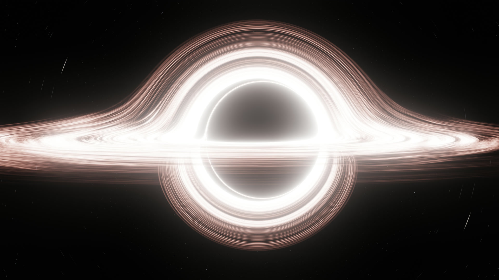
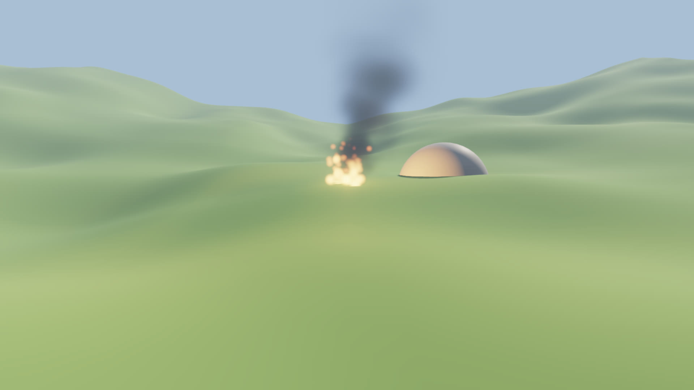
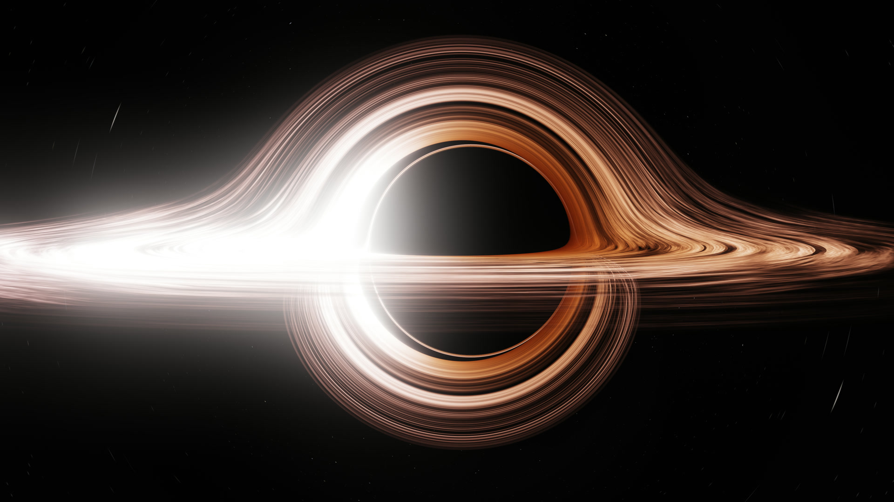
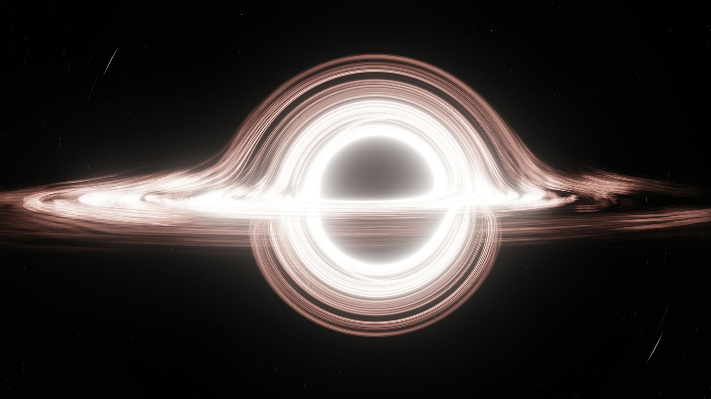
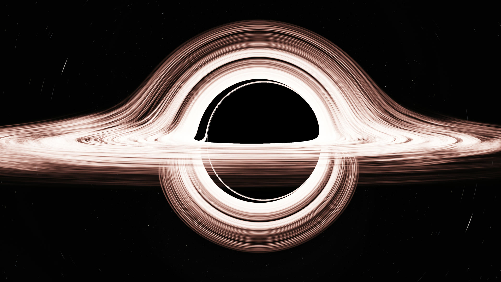

<div align="center">

<br>


<h1>Artful</h1>

<p><b>A 3D renderer. Written in C. Nothing else.</b></p>

<a href="https://github.com/eugeniobenfica/artful/releases/latest"></a>
<a href="LICENSE"></a>
<a href="docs/architecture.md"></a>
<br>
<a href="https://github.com/eugeniobenfica/artful/actions/workflows/ci.yml"></a>

<p>
<a href="#quick-start">Quick start</a> &nbsp;·&nbsp;
<a href="#download">Download</a> &nbsp;·&nbsp;
<a href="#building">Building</a> &nbsp;·&nbsp;
<a href="#documentation">Documentation</a> &nbsp;·&nbsp;
<a href="CHANGELOG.md">Changelog</a>
</p>

</div>

<br>

Artful is a 3D renderer in plain C11, with no dependencies: a C compiler and CMake build it, and a
program carries nothing else. Vulkan is opened at run time and its shaders are written by the library
itself, so there is no SDK to install and no shader compiler to run. Where Vulkan is not there, the
same scene is drawn on the CPU.

> **Made for** programs that draw 3D themselves: tools, viewers, pictures and video rendered offline, a scene under an interface.<br>
> **Not an engine:** no physics, no sound, no editor, no scripting. Not yet stable: [what is not there yet](docs/limits.md).

<div align="center">
<br>

<p><sub>A black hole, drawn by Artful with no asset: each ray follows Kerr's metric (<a href="#a-black-hole">how to draw it</a>).</sub></p>
</div>

## What is inside

| | |
| :--- | :--- |
| **Vulkan** | A whole scene in one indirect draw, culled by a compute shader. The CPU's part of a frame does not grow with the scene: about 0.05 ms with 90,000 instances. |
| **Software** | Works as a phone's GPU does: triangles are binned into tiles, and each tile is resolved in the cache, so every pixel is shaded once and the depth buffer never reaches main memory. All cores, with AVX2, SSE4.1 or NEON chosen at run time. |
| **Meshes** | 16 bytes a vertex, ordered for the vertex cache and cut into meshlets when they are added. Levels of detail made on the way in. |
| **Files** | glTF (`.gltf`, `.glb`) with nodes, PBR materials, normal maps, skins, clips, lights and cameras; PNG, JPEG, KTX2 and Radiance `.hdr`, read by its own decoders, on all cores. |
| **Lighting** | Physically based materials, a sun, up to 1024 spots and point lights (16 with shadow maps), exposure and fog; light from all around from a picture of it, reflected as rough as each surface is, and shown behind the scene. |
| **Light that bounced** | A grid of probes traced every frame, on any GPU or the CPU: light bounces once more each frame. |
| **After the frame** | With the frame in floats: bloom, ambient occlusion, screen-space reflections, fog that light goes through (lit through the sun's shadows), temporal antialiasing and depth of field. |
| **Particles and terrain** | Emitters of soft particles that fade as they age; terrain from heights, with levels of detail. |
| **Layers** | Colors on vertices, opacity, holes and two sided surfaces, frames with alpha and four samples a pixel: a model can go over something else, with smooth edges, on both backends. |
| **Rays and paths** | Real shadows and reflections, or all light however often it bounced, in place of triangles: on the CPU, or on any GPU by a compute shader, with no ray tracing hardware. A denoiser for what moves. |
| **Animation** | Skeletons, morph targets and glTF's clips: `artfAnimationSet`, with blending left to the program. |
| **Materials in C** | A material is an expression built by calls (`artfExprMul`), from which each backend makes its own code. |
| **Memory** | Compression on load; meshes and textures that can be removed; streaming run by the program, by Artful or by both. |
| **Overlay** | A picture over the scene, updated by damage rectangles: what a host needs to put an interface on top. |
| **Black hole** | Light traced through the curved space of a spinning hole, pixel by pixel, then high dynamic range, bloom and tone mapping: in real time, and the same picture on both backends. |

## Quick start

**1. Link it.** Add the sources to your project, or install them for `find_package(artful)`.

```cmake
add_subdirectory(artful)                  # or: find_package(artful REQUIRED)
add_executable(ball main.c)
target_link_libraries(ball PRIVATE artful::artful)
```

**2. Draw a scene.** This writes `ball.ppm`, a red ball under the sun.

```c
#include "artful/artful.h"
#include <stdio.h>
#include <stdlib.h>

int main(void) {
    ArtfScene* scene = artfSceneNew();
    ArtfMesh ball = artfSceneAddSphere(scene, 1.f, 32, 48);
    ArtfMaterialDesc red = {.baseColor = artfVec3(.8f, .1f, .1f), .specular = 1, .roughness = .3f};
    artfSceneAddInstance(scene, ball, artfSceneAddMaterial(scene, &red), NULL);
    artfSceneSetSun(scene, artfVec3(-1, -2, -1), artfVec3(3, 3, 3));
    ArtfCamera eye = {.position = {0, 1, 4}, .target = {0, 0, 0}, .up = {0, 1, 0}, .fovY = .8f, .near_ = .1f};
    artfSceneSetCamera(scene, &eye);

    ArtfRendererOptions options = {.width = 640, .height = 360};  /* Auto: Vulkan, then the CPU */
    ArtfRenderer* renderer = artfRendererNew(&options);
    artfRendererDraw(renderer, scene);

    uint32_t* pixels = malloc(640 * 360 * 4);                       /* BGRA */
    artfRendererReadPixels(renderer, pixels);
    FILE* f = fopen("ball.ppm", "wb");
    fprintf(f, "P6 640 360 255\n");
    for (int i = 0; i < 640 * 360; i++) fputc(pixels[i] >> 16, f), fputc(pixels[i] >> 8, f), fputc(pixels[i], f);
    fclose(f);

    free(pixels);
    artfRendererFree(renderer);
    artfSceneFree(scene);
}
```

To show frames in a window, give `ArtfRendererOptions.surface` your window's handle and call
`artfRendererDraw` each frame. [The API, by what it is for](docs/api.md).

<details>
<summary><b>A model from a file</b></summary>
<br>

```c
artfSceneLoadGltf(scene, "ship.glb", NULL);
```

```bash
build/artful-render --model ship.glb --trace paths --trace-samples 256 --out ship.png
```

A `.gltf` or a `.glb`, with its nodes, physically based materials, normal maps, PNG or JPEG textures,
lights and cameras (`artfModelCamera`). Its reader is this library's own, and so are the decoders; images and
meshes are made on all cores. `artfSetLog` says what a file holds that was left out.
</details>

<details>
<summary><b>After the frame</b>: bloom, occlusion, reflections, fog, temporal antialiasing, depth of field</summary>
<br>

```c
ArtfRendererOptions options = {.width = 1920, .height = 1080, .hdr = true};   /* the frame in floats */
ArtfPostDesc post = {.bloom = .05f, .occlusion = .8f, .reflections = 1, .temporal = true,
                     .volumetric = .5f, .scattering = .7f, .focus = 6, .aperture = 8};
artfSceneSetPost(scene, &post);
artfSceneSetExposure(scene, 1);
```

```bash
build/artful-render --scene outdoors --hdr --shadows 2048 --scene-exposure 1 --glow .04 --occlusion .8 \
  --temporal --indirect --fog .006 .62 .7 .82 --out outdoors.png
```

The same passes on both backends, with the same arithmetic. Without `hdr` nothing of it is there, and a frame is
made as it always was.

<div align="center">

<p><sub>Terrain, particles, a light, bloom, ambient occlusion, temporal antialiasing and light that bounced, on a Vega 8 (<code>--scene outdoors</code>).</sub></p>
</div>
</details>

<details>
<summary><b>Light that bounced</b>, and many lights</summary>
<br>

```c
ArtfIndirectDesc probes = {.probes = {8, 4, 8}, .rays = 64};   /* over the scene's bounds */
artfSceneSetIndirect(scene, &probes);
for (int i = 0; i < 500; ++i) artfSceneAddLight(scene, places[i], colors[i], 2.f);
```

Probes follow a few rays each frame and keep what reaches them; surfaces take light from all around from the probes
near them. Lights past the first 16 are listed by the 64 x 64 squares of the frame they reach.
</details>

<details>
<summary><b>Particles and terrain</b></summary>
<br>

```c
ArtfEmitterDesc fire = {.velocity = {0, 1.6f, 0}, .spread = .25f, .rate = 120, .life = .9f, .size = .45f,
                        .sizeEnd = .1f, .color = {1, .55f, .15f}, .colorEnd = {.8f, .15f, .05f}, .opacity = .9f, .glow = 6};
ArtfEmitter e = artfSceneAddEmitter(scene, &fire);
artfEmitterStep(scene, e, seconds);                                        /* each frame, after the camera */
ArtfMesh hills = artfSceneAddTerrain(scene, heights, 129, 129, .5f, 3.f, 8.f);
```
</details>

<details>
<summary><b>Light from all around</b>, from a picture</summary>
<br>

```c
int width, height;
float* sky = artfImageDecodeHdr(data, size, &width, &height);   /* a Radiance .hdr, equirectangular */
artfSceneSetEnvironment(scene, sky, width, height, 1.f, true);   /* light 1, and shown behind the scene */
artfFree(sky);
```

```bash
build/artful-render --environment studio.hdr --show-environment --out picture.png
```

The picture becomes maps: one sharp, four as rough surfaces reflect it, one of what a surface takes from all
around. Surfaces, reflections, rays and paths read them, on both backends, with the same arithmetic. About 40 ms
for a picture of 512 x 256.
</details>

<details>
<summary><b>Shadows</b></summary>
<br>

```c
ArtfShadowDesc shadows = {.resolution = 1024};
artfSceneSetShadows(scene, &shadows);              /* the sun, in three maps around the eye */
artfLightSetShadow(scene, lamp, true);             /* a spot takes one map, a point light six */
```

```bash
build/artful-render --scene spheres --shadows 2048 --out picture.png
```
</details>

<details>
<summary><b>A model over something else</b>: opacity, alpha, antialiasing</summary>
<br>

```c
ArtfVertex corner = {x, y, z, nx, ny, nz, u, v, 0xFF2080E0};  /* BGRA; 0 is white */

artfInstanceSetOpacity(scene, instance, .5f);   /* what is behind it shows */
artfSceneSetBackgroundAlpha(scene, 0);          /* the frame's alpha is what the scene covers */

ArtfRendererOptions options = {.width = 1920, .height = 1080, .antialias = true};
```

Frames are premultiplied, as a window's and as the overlay are. A color's alpha works as opacity does.
What shows through is a layer: it is drawn after all that is solid, the farthest first, and shows its
nearest surface, so that a model fading out does not show its own insides.

A material says what a texture's alpha means, as glTF's do:

```c
ArtfMaterialDesc leaf = {.baseColor = {1, 1, 1}, .texture = leaves, .specular = 1, .roughness = .6f,
                         .alphaMode = ARTF_ALPHA_MASK, .doubleSided = true};
ArtfMaterialDesc glass = {.baseColor = {.8f, .9f, 1}, .specular = 1, .roughness = .1f,
                          .alphaMode = ARTF_ALPHA_BLEND, .transparency = .7f};
```

```bash
build/artful-render --scene layers --antialias --clear --out layer.png
```
</details>

<details>
<summary><b>Rays and paths</b></summary>
<br>

```c
ArtfTraceDesc trace = {ARTF_TRACE_PATHS, .maxSamples = 512};
artfSceneSetTrace(scene, &trace);
for (;;) artfRendererDraw(renderer, scene);   /* each frame adds to the last, until the scene changes */
```

`ARTF_TRACE_RAYS` is what the rasterizer shows, with real shadows, reflections in what shines, and
everything behind what shows through. `ARTF_TRACE_PATHS` follows all light: colors bleed from one
surface to the next. The same scene goes in, with the same materials and lights, and neither needs
hardware for rays.

```bash
build/artful-render --scene layers --trace paths --trace-samples 512 --out picture.png
```

Paths are for pictures and video, not yet for a game: a sample of each pixel of `layers`, at 1920 x
1080, takes about 430 ms on the Ryzen's CPU and 120 ms on its Vega 8.
</details>

<details>
<summary><b>Features</b>: levels of detail, occlusion, cones</summary>
<br>

Each can be switched at any time, or from the environment: `ARTFUL_FEATURES=-lod,+occlusion`.

```c
artfSceneSetFeature(scene, ARTF_FEATURE_OCCLUSION, true);
```

| Feature | Default | |
| --- | --- | --- |
| `ARTF_FEATURE_LOD` | on | Far objects use lighter meshes, made when a mesh is added. `artfSceneSetLodError` says how far they may stray, in pixels. |
| `ARTF_FEATURE_OCCLUSION` | off | What is behind other things is not drawn, in two passes, so the picture never changes. Up to 19 times faster where much is hidden; up to 30% slower where nothing is. |
| `ARTF_FEATURE_CONES` | on | The CPU drops meshlets that face away before reading their vertices. |
</details>

<details>
<summary><b>Under an HTML page</b>, with cascade</summary>
<br>

Artful can be a presenter of [cascade](https://github.com/eugeniobenfica/cascade), an HTML and CSS
interface library in plain C of the same family: a page over a 3D scene, in a few lines. Neither
library depends on the other: the bridge is a target of its own, `artful::cascade`, in
`integrations/cascade`. See [Artful under a page](docs/cascade.md).
</details>

### A black hole

No asset: each ray follows the path Kerr's metric gives it, around a spinning hole, through a disc of
gas with depth and out to the stars. Each ring of gas turns at the speed of its own orbit. The disc's
far side shows above and below the hole because that is where its light comes from, and the shadow
sits off center because space itself is being dragged around. The disc is the one of the film
*Interstellar*, set against the figures of the paper of those who made it ([James et al.,
2015](https://arxiv.org/abs/1502.03808)): gas as an artist would paint it, in strands like hair, torn
into clouds further out, with lanes of dark dust, at one temperature tinted toward salmon, seen through
the veil of an IMAX lens. Its view and its spin are theirs too.

```c
ArtfBlackHoleDesc hole = artfBlackHoleDefaults();
artfSceneSetBlackHole(scene, &hole);
```

| As it would really look | Spinning nearly as fast as a hole can | Without the lens's veil |
| --- | --- | --- |
|  |  |  |

<details>
<summary><b>The commands behind these pictures</b></summary>
<br>

```bash
build/artful-render --scene blackhole --size 3840 2160 --samples 8 --exposure .6 --out hole.png
build/artful-render --scene blackhole --doppler 1 --exposure .45 --out real.png
build/artful-render --scene blackhole --spin .99 --exposure .5 --out fast.png
build/artful-render --scene blackhole --bloom 0 --exposure .8 --out clear.png
build/artful-blackhole

# twelve seconds of a slow approach, at 60 frames a second, with motion blur
build/artful-render --scene blackhole --size 1920 1080 --samples 8 --exposure .42 --shutter .22 \
  --sequence 720 --step .45 --distance 74.1 --to-distance 62 --tilt 2 --to-tilt 5 --to-around 25 \
  --out frames/%04d.png       # (into a folder that is already there)
```

The second is what such a hole would really look like: all of what relativity does, the gas coming at
the eye far brighter and bluer than the gas going away. The film left that out, as the first does. The
third spins nearly as fast as a hole can: the shadow's left edge goes flat, which the film thought too
confusing to show. The fourth is without the veil of the lens.

Each picture here was drawn at 3840 x 2160 and 64 rays a pixel (`--samples 8`), six seconds on a
Vega 8, and is shown at 1920 x 1080. `artful-blackhole` is a window on it (Windows): the eye orbits,
at the speed of an orbit, and can be taken anywhere. The last command writes the frames of a film,
about a second and a half each on a Vega 8. How it works is [here](docs/architecture.md#a-black-hole).
</details>

## Platforms

| | Backends | Support |
| :--- | :--- | :---: |
| **Windows** x64 | Vulkan, software (GCC, clang) | Tier 1 |
| **Android** arm64 | Vulkan, software | Tier 1 |
| **Linux** x64 | Vulkan, software (GCC, Clang) | Tier 2 |
| **macOS** | software; Metal | Tier 2 |
| **Windows** x64, MSVC | Vulkan, software | Tier 2 |
| **Android** armv7, x86-64 | Vulkan, software | Tier 2 |
| **iOS** | software; Metal | Tier 2 |

**Tier 1**: all tests and a real window with a page over the scene, run on an AMD GPU (Windows) and an
Adreno GPU (Android).<br>
**Tier 2**: experimental. [CI](.github/workflows/ci.yml) builds Linux, macOS, MSVC and every Android ABI and runs
the tests on Linux (on a software Vulkan, under validation and sanitizers), macOS (on the CPU) and MSVC; none of
them has opened a window. iOS is written, not built. **Metal has never been run**, so it is chosen only by name.

Vulkan needs version 1.2, `drawIndirectFirstInstance` and non-uniform texture indexing; a device
without them draws on the CPU, which needs only a C compiler.

<details>
<summary><b>Measured</b></summary>
<br>

1920 x 1080, milliseconds a frame, with `artful-render`, the features at their defaults. GPU times run
to the last pixel of a run of frames.

| Scene | Vega 8 | Ryzen 3 3200G, 4 cores | Adreno 830 | Snapdragon 8 Elite, 8 cores |
| --- | ---: | ---: | ---: | ---: |
| `spheres`: 4 objects, textured, lit | 1.5 | 16 | 0.74 | 4.2 |
| `heavy`: 16 spheres, 1.57 million triangles | 1.2 | 9.6 | 0.74 | 3.7 |
| `field --side 300`: 90,000 instances | 6.8 | 89 | 5.4 | 53 |
| `city`, with occlusion on: 40,000 objects behind a wall | 2.5 | 37 | 0.81 | 16 |
| `blackhole`: 2 million rays, each its own path, a step of the fluid, then bloom | 23 | 141 | 8 to 36* | 80 to 130* |
| `lights`: 256 lights | 12 | 50 | | |
| `spheres --hdr`, then each of: bloom, occlusion, reflections, fog that light goes through, temporal, focus | +5, +8, +12, +9, +8, +6 | +25, +70, +45, +50, +25, +95 | | |

\* Measured before the disc was painted as the film's, which reads a larger map: on the Vega 8 that cost a tenth.

`libartful.a` is about 1.4 MB; `artful-render`, linked statically, about 1.3 MB.
</details>

## Download

| Platform | SDK |
| :--- | :--- |
| **Windows** x64, MinGW-w64 | [artful-0.3.0-windows-x64-mingw.zip](https://github.com/eugeniobenfica/artful/releases/download/v0.3.0/artful-0.3.0-windows-x64-mingw.zip), with `artful-render` and `artful-blackhole` |
| **Windows** x64, MSVC | [artful-0.3.0-windows-x64-msvc.zip](https://github.com/eugeniobenfica/artful/releases/download/v0.3.0/artful-0.3.0-windows-x64-msvc.zip) |
| **Android** arm64, armv7, x86_64 | [artful-0.3.0-android.zip](https://github.com/eugeniobenfica/artful/releases/download/v0.3.0/artful-0.3.0-android.zip) |

Each SDK holds the static library, its headers and a CMake package for `find_package(artful)`; checksums are in
`SHA256SUMS.txt`. On Linux and macOS, build it from the sources: it takes a few seconds.

## Building

```bash
cmake -S . -B build -G Ninja
cmake --build build
build/artful-tests
build/artful-render --out picture.png
```

A C11 compiler and CMake 3.16: GCC or Clang (MinGW-w64 on Windows). Nothing else, not even the Vulkan
SDK. `cmake --install build --prefix <dir>` installs it for `find_package(artful)`.

<details>
<summary><b>Build options</b></summary>
<br>

| Option | Default | |
| --- | :---: | --- |
| `ARTFUL_VULKAN` | `ON` | the GPU backend; off, a lighter library, drawing on the CPU |
| `ARTFUL_BUILD_TOOLS`, `ARTFUL_BUILD_TESTS` | top level | `artful-render`, `artful-blackhole`, `artful-shaders`, `artful-tests` |
| `ARTFUL_CASCADE_DIR` | empty | cascade's source folder: builds the bridge to it (`artful::cascade`), its example and its tests |
| `ARTFUL_CASCADE` | `OFF` | the same, with an installed cascade (`find_package`) |
</details>

<details>
<summary><b>What is where</b></summary>
<br>

```
include/artful/   the API: core.h, scene.h, renderer.h
src/core/         memory, threads
src/scene/        scenes; meshBuild.c packs and orders meshes, simplify.c makes lighter ones, trace.c follows
                  rays, gltf.c and imageDecode.c read files
src/render/       the choice of a backend
src/software/     the CPU backend: kernels.inc is built once for each instruction set, on simd.h
src/vulkan/       the GPU backend: vulkanApi.h, spirv.c and the shaders in shaders.c
src/metal/        the GPU backend for Apple's systems, never run: metal.c, and shaders.inc, which is generated
tools/            artful-render, artful-blackhole, artful-shaders, mkmetal.py; androidTest.sh for a device
tests/            tests.c
integrations/     bridges to other libraries, each a target of its own and named by nothing above
  cascade/        artful::cascade: include/artful/cascade.h, its example, its window tests, its APK
```
</details>

## Quality

- **Pixels, proved.** The tests hold the hashes of reference pictures: a change that moves a drawn pixel shows. The same scene gives the same bytes on x86 and ARM on the CPU, with levels of detail off.
- **Validation.** CI runs the tests on a software Vulkan (Mesa's lavapipe) under the validation layers, synchronization included, checks every shader with `spirv-val` and Metal's through Apple's compiler, on Linux, macOS, Windows and Android.
- **Every mode.** The tests run again as a device without multi-draw, and with occlusion on, on GCC and Clang, and under AddressSanitizer and UndefinedBehaviorSanitizer.

## Principles

- **No dependencies.** Only what the system provides, opened at run time where it can be. The glTF reader, the image decoders and the SPIR-V are written here.
- **Named by nothing.** Artful's own headers name no other library; bridges live in `integrations/`, each a target of its own.
- **The same picture.** A scene looks the same on both backends, and the CPU is always there to draw it.
- **cascade's conventions.** Types are `ArtfPascalCase`, functions `artfCamelCase`, macros and enum values `ARTF_UPPER`. A function that returns a pointer says whether the caller owns it; everything else is borrowed.

## Documentation

| | |
| :--- | :--- |
| [The API](docs/api.md) | The calls, by what they are for. |
| [Architecture](docs/architecture.md) | How it works, and why. |
| [Artful under a page](docs/cascade.md) | The bridge to cascade: a page over a 3D scene. |
| [What is not there yet](docs/limits.md) | What it does not do, or does only in part. |
| [Stability](docs/stability.md) | What stands between this and a stable version. |
| [Roadmap](docs/roadmap.md) | What comes next, and in what order. |
| [Performance and platforms](docs/performanceAndPlatforms.md) | The study behind these choices. |

## License

MIT. See [LICENSE](LICENSE).

<div align="center">

<p><sub><b>A 3D renderer. Written in C. Nothing else.</b></sub></p>
</div>
